# CQUPT_Card 

> 一个更轻、更快、更顺手的重邮一卡通客户端。

  
  
  
  

## 安装说明

去 [Releases](../../releases/latest) 下 `cqupt-yikatong-x.y.z.apk`并在手机上安装。

首次打开填统一认证码和密码（初始为身份证后六位）。
账号密码只保存在本机，用于会话过期后自动续期，不经过任何第三方服务器。

> 本仓库仅对**原重邮一卡通**App进行客户端重写，不修改、不代理、不存储学校任何数据；所有业务仍由学校一卡通系统鉴权与记账。

## 界面预览

| | | |
| --- | --- | --- |
| 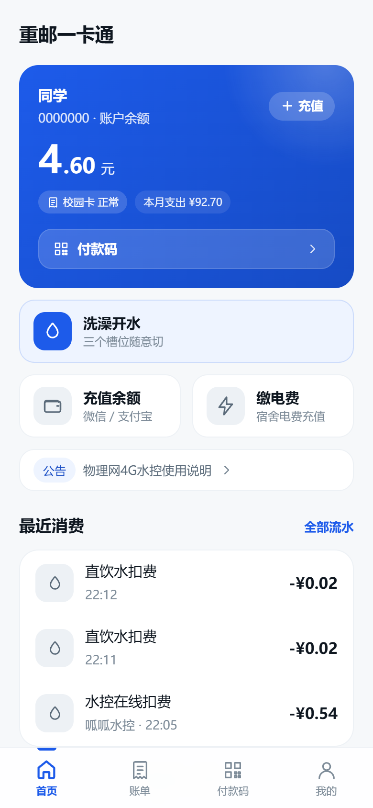 | 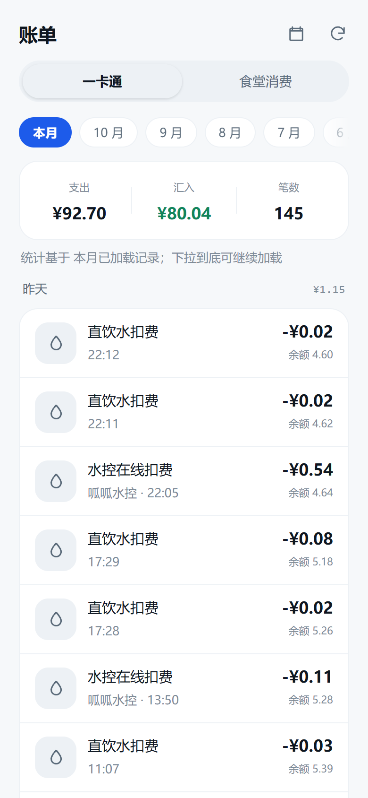 | 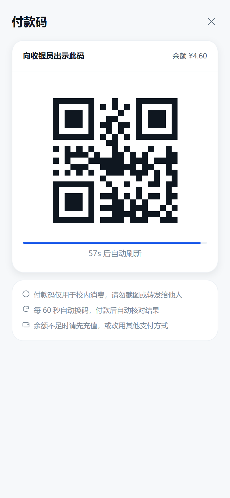 |
| 首页 | 账单（一卡通 / 食堂两本账） | 付款码 |
| 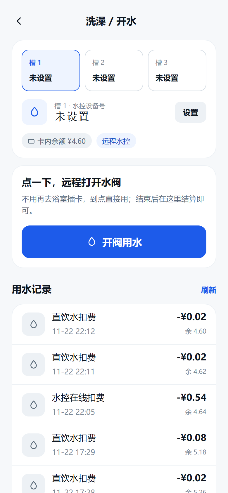 | 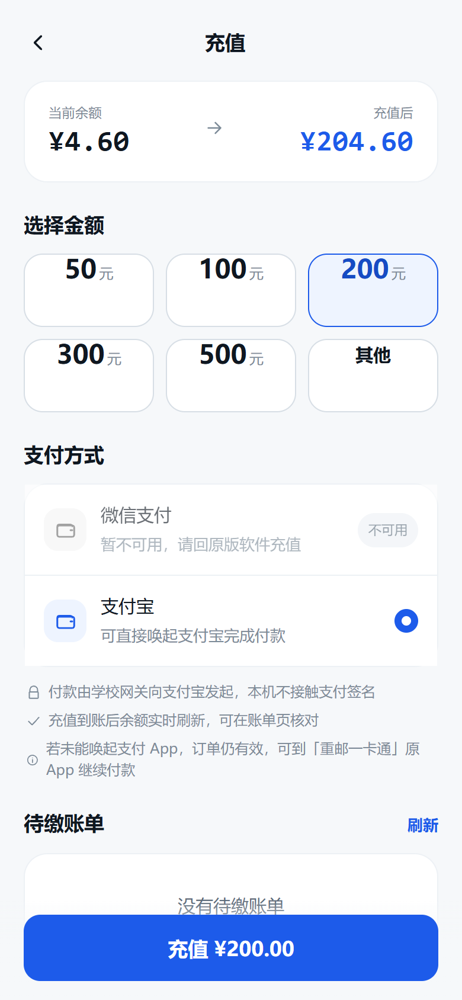 | 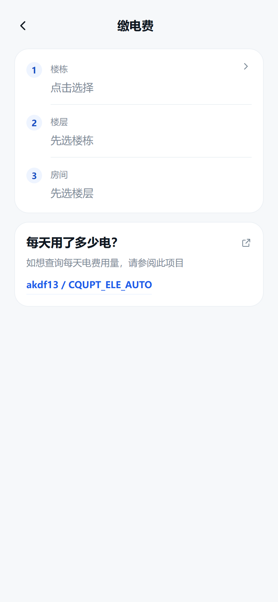 |
| 洗澡 / 开水（三槽位记忆） | 充值 | 缴电费 |
| 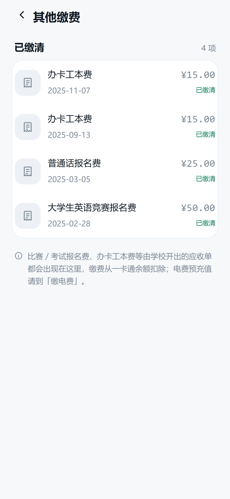 | 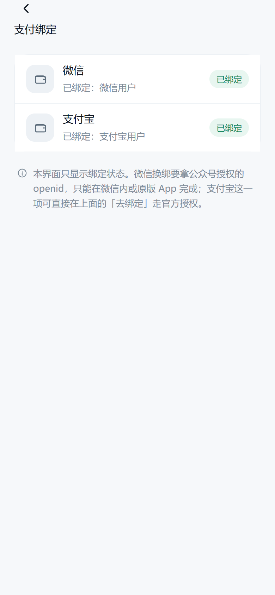 | 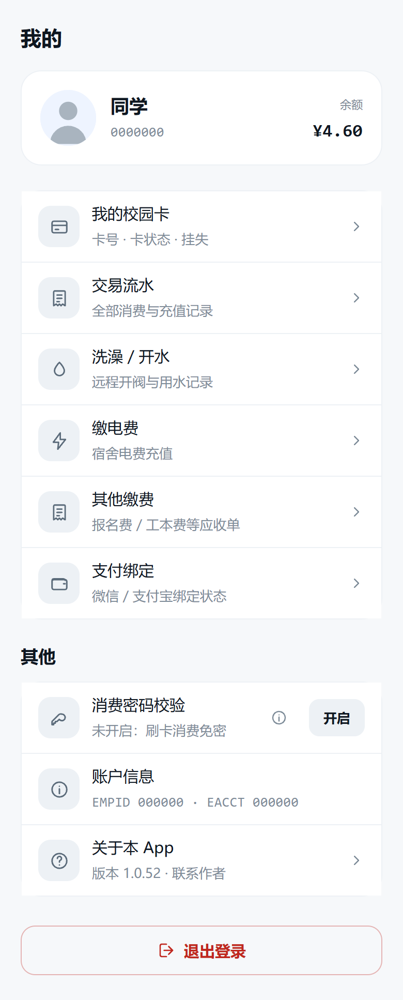 |
| 其他缴费 | 支付绑定 | 我的 |
| 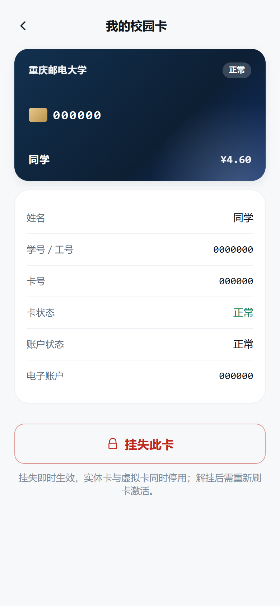 | 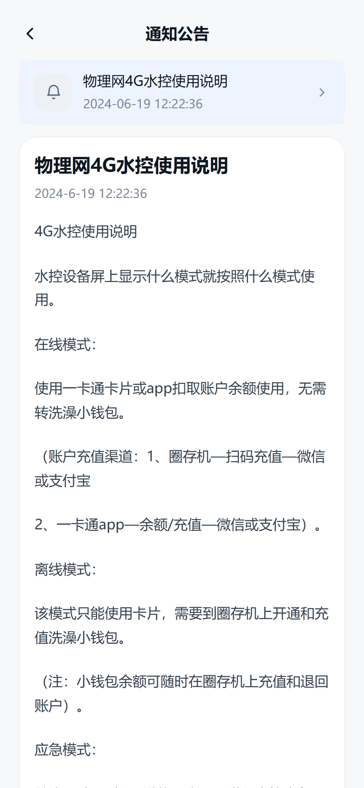 | 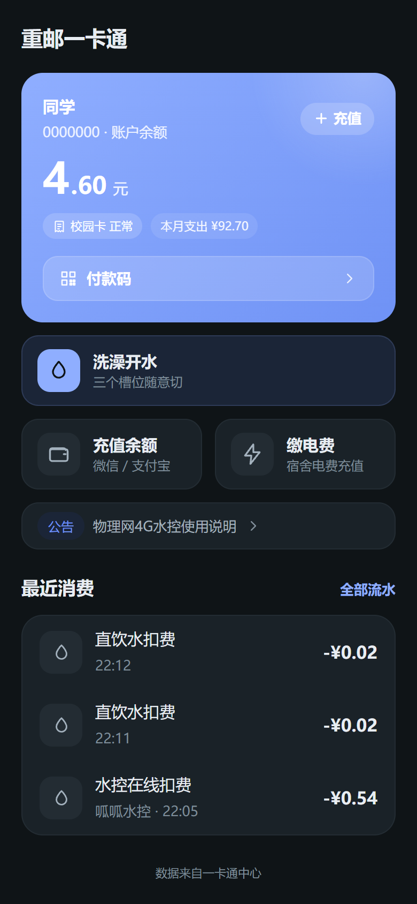 |
| 我的校园卡 | 通知公告 | 深色模式 |
